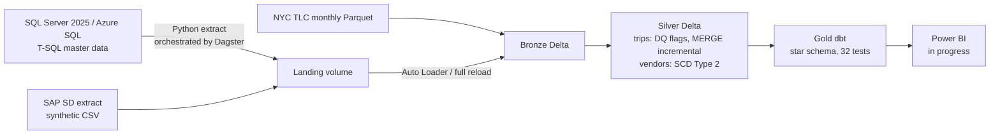
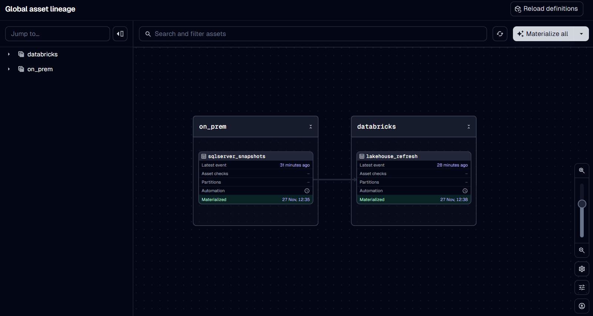
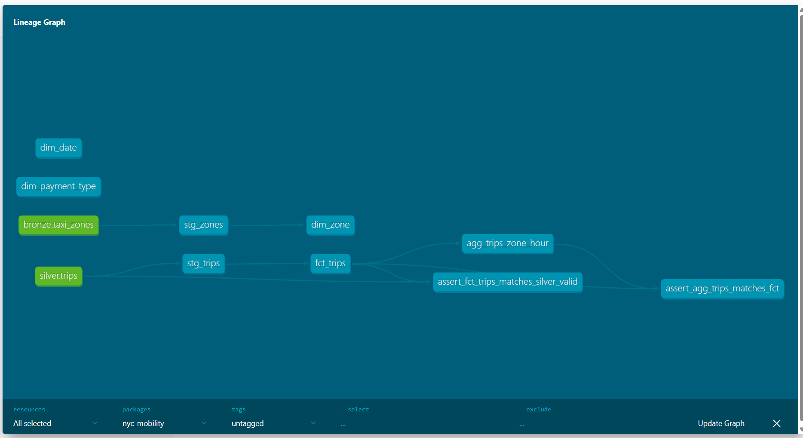

# NYC Mobility Lakehouse

Fleet operations analytics on **80.9 million NYC taxi trips** (2023-2024), built as a Databricks lakehouse that combines a public trip feed, on-prem SQL Server master data and an SAP billing extract.

**dbt docs and lineage:** https://alydk.github.io/nyc-mobility-lakehouse/

**Stack:** Databricks (Spark, Delta Lake, Unity Catalog, Auto Loader, Workflows, Asset Bundles), dbt-databricks, SQL Server 2025, Azure SQL Database, T-SQL, Python, Dagster, GitHub Actions, Power BI.

## Business questions
- Where and when is demand highest (zone, hour, weekday)?
- What does a trip and an hour earn, and how do tips and surcharges behave?
- How do airport trips and Flex Fare (upfront price) trips differ?
- What do corporate accounts generate, and does SAP billing match the trips behind it?
- How trustworthy is the data, and what was excluded and why?

## Architecture

Orchestration: **Dagster** (on-prem) extracts SQL Server, then triggers the **Databricks job** (8 tasks: 5 Bronze loads in parallel, 2 Silver, dbt Gold).

## Data volumes

| Layer | Table | Rows |
|---|---|---|
| Bronze | `bronze.yellow_trips` | 79,479,946 |
| Bronze | `bronze.green_trips` | 1,447,278 |
| Silver | `silver.trips` | 80,927,217 |
| Gold | `gold.fct_trips` (valid trips) | 78,270,141 |
| Gold | `gold.agg_trips_zone_hour` (Power BI grain) | 5,528,650 |
| Gold | `gold.fct_billing_items` (SAP invoices) | 2,880 items, 960 invoices |

## Engineering highlights

**Lakehouse**
- **Schema drift:** source files change column case and types between years; Bronze normalises them to one schema.
- **Idempotent loads:** each month is replaced with Delta `replaceWhere` and logged in `ops.ingest_manifest`; re-running a month never duplicates.
- **Incremental Silver:** only changed months are processed with `MERGE`. Reloading one month updated 2,964,624 rows, inserted 0, deleted 0.
- **Quality by flagging, not deleting:** invalid rows keep a `dq_flags` array, so Silver always reconciles to Bronze.
- **Reconciliation tests:** fact equals valid Silver trips; aggregate equals fact to the cent. This caught a $0.01 floating-point drift across 78M rows, fixed with `DECIMAL`.

**SQL Server and Azure SQL (T-SQL)**
- Database-neutral scripts deployed to **SQL Server 2025** and **Azure SQL Database** with `sqlcmd`.
- `ref.usp_set_vendor_fee`: validated (`THROW`), transactional (`XACT_ABORT`, `TRY/CATCH`, `UPDLOCK`) and audited into `ref.vendor_change_log`.
- Extract views are the stable contract the lakehouse reads.

**On-prem to cloud, with history**
- Python extracts the views to timestamped Parquet snapshots; **Auto Loader** ingests each file exactly once.
- `silver.dim_vendor_scd2`: **SCD Type 2** with Delta `MERGE` (close the changed row, insert the new version, close missing vendors) and a watermark so reruns only apply new snapshots.

**SAP (synthetic extract, real conventions)**
- Simulated SAP SD extract: `KNA1` customers, `MARA`/`MAKT` materials, `VBRK`/`VBRP` billing documents, with client `MANDT`, zero-padded keys, `YYYYMMDD` dates and semicolon CSV.
- dbt staging converts SAP formats; Gold adds `dim_customer`, `dim_material`, `fct_billing_items`.
- Tests prove every invoice header equals its items, and **SAP billing equals the corporate trips it was billed from, to the cent** ($71,543,629.15, 2,904,075 trips).

**Orchestration, CI, docs**
- Databricks Asset Bundle defines the job as code; monthly schedule (paused).
- Dagster assets: `sqlserver_snapshots` → `lakehouse_refresh` (triggers the job, fails on any non-success).
- CI validates the bundle, parses dbt and blocks data files; dbt docs publish automatically.

## Data quality findings

| Rule | Yellow | Green | Treatment |
|---|---|---|---|
| Negative fare or total | 1,117,350 | 4,437 | Invalid |
| Zero distance | 1,549,760 | 74,068 | Invalid |
| Distance over 200 miles | 2,131 | 802 | Invalid |
| Drop-off not after pickup | 29,079 | 1,695 | Invalid |
| Duration over 24 hours | 442 | 0 | Invalid |
| Pickup outside the file's month | 1,150 | 305 | Invalid |
| Passenger count 0 | 984,359 | 12,936 | Flag only |
| Unknown zone (264/265) | 1,059,251 | 18,203 | Flag only |
| Exact duplicates | 7 | 0 | Removed |

**Finding:** 5.4M yellow trips have no passenger count. They are exactly the trips with payment type 0, which the TLC data dictionary (March 2025) defines as **Flex Fare** (app-based upfront price). They are valid trips and are marked `is_flex_fare`.

## What is real and what is synthetic
- **Real:** all trip data (NYC TLC public trip records) and the TLC zone, vendor and rate code reference values.
- **Synthetic:** vendor platform fees and their change history (to demonstrate SCD2), and the SAP extract (corporate customers and invoices, derived from real trips by a documented rule). No real SAP system was used.

## Repository layout
- `databricks/` Bronze and Silver notebooks (source format)
- `dbt/` Gold models, tests and docs
- `sqlserver/` T-SQL for SQL Server and Azure SQL
- `scripts/` SQL Server extract
- `orchestration/` Dagster definitions
- `sap/` SAP SD extract simulator
- `databricks.yml` Databricks Asset Bundle (job definition)
- `.github/workflows/` CI and docs publishing

## Run it yourself
1. Databricks Free Edition workspace, Databricks CLI, Python 3.12, SQL Server (or Azure SQL).
2. Set `DATABRICKS_HOST`, `DATABRICKS_TOKEN`, `DATABRICKS_HTTP_PATH`.
3. Run `databricks/00_setup.sql` once. Deploy SQL Server objects: `sqlserver/00` (on-prem only), then `01` and `02` with `sqlcmd -d <database> -i <file>`.
4. Initial history: run `10_bronze_ingest` with `start_month=2023-01`, `end_month=2024-12` for each service; run `sap/generate_sap_extract` once.
5. `databricks bundle deploy`, then either `databricks bundle run nyc_mobility_pipeline` or `dagster dev -f orchestration/dagster_pipeline.py` and materialize all.

## Status
- **Done:** Bronze, Silver, Gold, SQL Server and Azure SQL, SCD2, SAP-style billing, orchestration (Workflows and Dagster), CI, docs.
- **In progress:** Power BI dashboard.