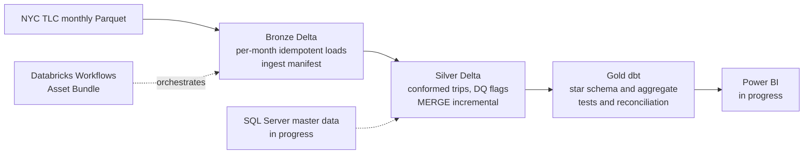
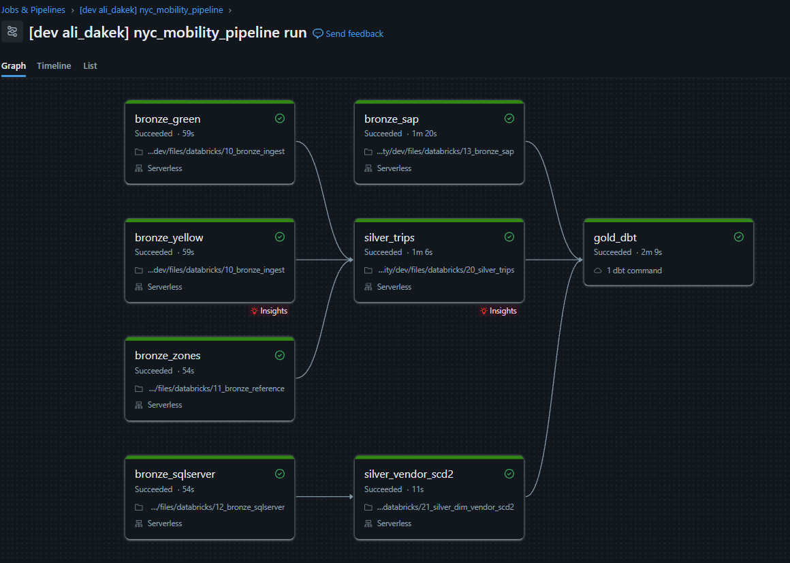

# NYC Mobility Lakehouse

Fleet operations analytics on **80.9 million NYC taxi trips** (2023-2024), built as a Databricks lakehouse with Spark, Delta Lake, dbt and Databricks Workflows.

**dbt docs and lineage:** https://alydk.github.io/nyc-mobility-lakehouse/

## Business questions
- Where and when is demand highest (zone, hour, weekday)?
- What does a trip and an hour earn, and how do tips and surcharges behave?
- How do airport trips and Flex Fare (upfront price) trips differ?
- How trustworthy is the data, and what was excluded and why?

## Architecture

| Layer | Table | Rows |
|---|---|---|
| Bronze | `bronze.yellow_trips` | 79,479,946 |
| Bronze | `bronze.green_trips` | 1,447,278 |
| Silver | `silver.trips` | 80,927,217 |
| Gold | `gold.fct_trips` (valid trips) | 78,270,141 |
| Gold | `gold.agg_trips_zone_hour` (Power BI grain) | 5,528,650 |

## Engineering highlights
- **Schema drift:** source files change column case and types between years. Bronze lower-cases names and casts to one canonical schema.
- **Idempotent loads:** each month is replaced with Delta `replaceWhere`, logged in `ops.ingest_manifest` (source rows vs written rows). Re-running a month never duplicates.
- **Incremental Silver:** only months whose Bronze load is newer are processed, with `MERGE` (update, insert, delete rows that vanished). Proof: reloading one month updated 2,964,624 rows, inserted 0, deleted 0.
- **Data quality by flagging, not deleting:** invalid rows stay in Silver with a `dq_flags` array, so Silver always reconciles to Bronze.
- **Reconciliation tests:** the fact table must equal the valid Silver trips, and the aggregate must equal the fact to the cent. This caught a $0.01 floating-point drift across 78M rows; money is now `DECIMAL(10,2)` and totals match exactly ($2,246,592,993.05).
- **Orchestration as code:** a Databricks Asset Bundle defines the job (three Bronze tasks in parallel, then Silver, then dbt). Full run: 4m 32s. Monthly schedule, paused.
- **CI:** every push validates the bundle, parses the dbt project, checks Databricks access and blocks data files. dbt docs publish automatically.

## Data quality findings

| Rule | Yellow | Green | Treatment |
|---|---|---|---|
| Negative fare or total | 1,117,350 | 4,437 | Invalid |
| Zero distance | 1,549,760 | 74,068 | Invalid |
| Distance over 200 miles | 2,131 | 802 | Invalid |
| Drop-off not after pickup | 29,079 | 1,695 | Invalid |
| Duration over 24 hours | 442 | 0 | Invalid |
| Pickup outside the file's month | 1,150 | 305 | Invalid |
| Passenger count 0 | 984,359 | 12,936 | Flag only |
| Unknown zone (264/265) | 1,059,251 | 18,203 | Flag only |
| Exact duplicates | 7 | 0 | Removed |

**Finding:** 5.4M yellow trips have no passenger count. They are exactly the trips with payment type 0, which the TLC data dictionary (March 2025) defines as **Flex Fare** (app-based upfront price). They are valid trips and are marked `is_flex_fare`.

## Repository layout
- `databricks/` Bronze, Silver and profiling notebooks (source format)
- `dbt/` Gold models, tests and docs
- `databricks.yml` Databricks Asset Bundle (job definition)
- `sqlserver/` T-SQL master data (in progress)
- `.github/workflows/` CI and docs publishing

## Run it yourself
1. Databricks Free Edition workspace, Databricks CLI, Python 3.12.
2. Set `DATABRICKS_HOST`, `DATABRICKS_TOKEN`, `DATABRICKS_HTTP_PATH`.
3. Run `databricks/00_setup.sql` once, then `databricks bundle deploy` and `databricks bundle run nyc_mobility_pipeline`.
4. For the initial history, run `10_bronze_ingest` with `start_month=2023-01`, `end_month=2024-12` for each service.

## Status and scope
- **Done:** Bronze, Silver, Gold, orchestration, CI, docs.
- **In progress:** SQL Server master data (T-SQL, SCD2), SAP-style extract, Power BI dashboard.
- **Data:** trip data is real public NYC TLC data. Master data and the SAP-style extract are synthetic and will be labelled as such.